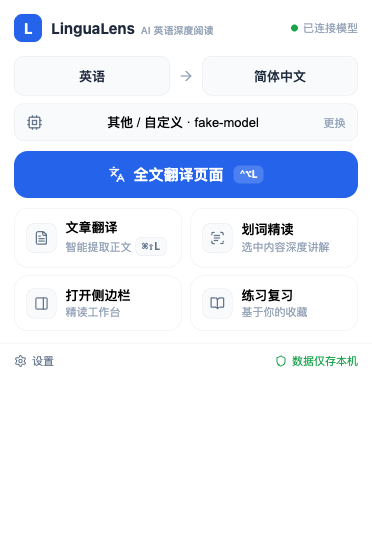
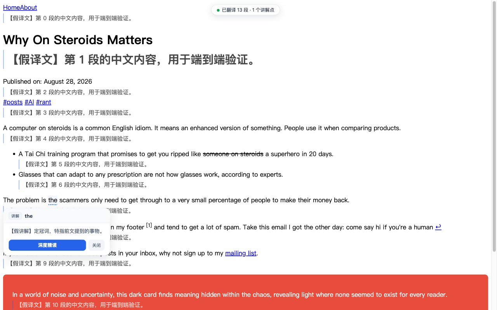

# LinguaLens — AI 英语深度阅读助手

> 选中即精读的 Chrome 扩展。不止翻译，讲透英语为什么这样表达。

  

**弹窗主面板**



**页面注入翻译 + 讲解卡**（虚线标注的表达，点击弹出"什么意思 + 为什么这样写"）



## 为什么做这个

市面上的翻译工具把英文变成中文就结束了。但学英语的人真正卡住的是**为什么**：
为什么这里用完成时、"get through to" 为什么不能逐词翻、这个词的构词逻辑是什么、
英语和中文的表达习惯差在哪。LinguaLens 把这些"为什么"做成了选中即得的结构化讲解。

核心纪律（写在 [prompts/common_discipline.md](prompts/common_discipline.md)，AI 输出的硬约束）：
不编造词源与语法规则、不确定必须标注、区分**语法规则 / 语言习惯 / 作者风格**三类知识、讲作用不贴标签。

## 功能特性

**🔍 划词精读**：选中任意英文（词/短语/句/段），四模式自动路由，返回结构化讲解——双轨翻译、
意群拆解、语法"为什么"、词汇构词、中英表达差异；支持多轮追问、收藏进知识库、基于收藏生成练习（含仿写 AI 批改）。

**📄 文章翻译**：智能定位正文容器（含"页面主文本占比 ≥20%"守门，HN 这类讨论帖自动整页注入），
逐段双语对照注入原文下方，标题一并翻译。

**🌐 全文翻译**：页面所有可见文字就地对照，重点表达虚线下划线，点击弹讲解卡。

**💰 省 token 三件套**：URL+内容指纹缓存（二次翻译 0 请求）、段落级译文记忆（跨页面复用）、
内容变化增量重翻（只翻变了的段落）。

**🧭 跨批一致性**：长文按 2400 字符分批（批内段落互相可见），批间用术语表 + 上一批滚动对照衔接，
代词指代与译名不漂移（token 开销约 +15%）。

**小白友好**：8 家厂商预设（选完只填 Key）、密钥 AES 加密存本机、设置改动自动保存、
翻译全程有状态（转圈占位/进度条/失败标红）。

## 快速开始

### 方式一：下载安装包（推荐）

1. 下载最新安装包：<https://toolsfox.top/downloads/lingualens-latest.zip>，解压
2. Chrome 打开 `chrome://extensions/` → 开启右上角「开发者模式」→「加载已解压的扩展程序」→ 选择解压出的文件夹
3. 点工具栏 LinguaLens 图标 → 点模型行进设置 → 选厂商、贴密钥 → 「保存并测试连接」
4. 随便打开一个英文网页，选中一段文字开读

要求 Chrome 114+（Side Panel API）。免安装更新见[自动更新](#自动更新免删除重装)。

### 方式二：油猴 / 脚本猫（Lite 版，无需扩展权限）

不想装扩展？**LinguaLens Lite** 用户脚本版保留核心三件套：划词精读、整页注入对照翻译、讲解卡（无侧边栏工作台/练习/知识库 UI，其余逻辑与扩展同源）。

1. 先装 [Tampermonkey 油猴](https://www.tampermonkey.net/)（Chrome/Edge/Firefox/Safari 均可）或 [ScriptCat 脚本猫](https://scriptcat.org/)
2. 安装脚本（二选一）：
   - 直装链接：<https://origin.toolsfox.top/downloads/lingualens-lite.user.js>（脚本管理器自动弹安装页；橙云 CF 会拦 .user.js 路径，故直装走灰云子域）
   - 或从 <https://github.com/istoolsfox/lingualens> 仓库 `dist-userscript/lingualens-lite.user.js` 手动导入
3. 脚本管理器菜单 →「⚙ LinguaLens 设置」→ 选厂商贴密钥
4. 选中网页英文 → 浮动栏「AI 精读 / 翻译 / 解释 / 全文」

说明：

- **密钥同样 AES-256-GCM 加密**存于脚本管理器存储（与扩展同一段加密代码）；数据仅存本机
- 跨域直连靠 `GM_xmlhttpRequest`，脚本头已声明 8 家预设厂商域名；**用自定义厂商需自行在脚本头加一行 `@connect <你的API域名>`** 后更新脚本
- 想上架 Greasy Fork / 脚本猫市场的用户：脚本已符合其源码可读与 @connect 规范，可直接发布（欢迎自行发，或提 Issue 通知我们统一维护）

### 方式三：从源码构建

```bash
git clone https://github.com/istoolsfox/lingualens.git
cd lingualens
pnpm install
pnpm build
```

然后同上，`chrome://extensions` 加载 `dist/` 目录。

## 使用入口（五路）

1. **浮动栏**：选中 → 「AI 精读 / 翻译 / 解释 / 全文 / 收藏」（长选区自动截断并提示）
2. **图标激活**：点工具栏图标 → 自动读取当前页选区并打开侧边栏
3. **手动输入**：侧边栏输入框直接粘贴英文
4. **快捷键 `Alt+L`（Mac `⌘⇧L`）**：翻译本文（Readability 智能提取正文，可到 chrome://extensions/shortcuts 改键）
5. **自定义快捷键（默认 `Ctrl+Alt+L` / Mac `⌃⌥L`）**：全文翻译注入页面 + 讲解虚线，设置页内直接录制改键（按物理键位 `e.code` 匹配，Alt/⌥ 组合键改变 `e.key` 字符也不失效）

## 隐私与安全（无后端设计）

- **无后端**：AI 请求由你的浏览器直连你选择的厂商（OpenAI 兼容接口），不经任何中间服务器
- **密钥加密**：API 密钥 AES-256-GCM 加密落盘（WebCrypto 设备密钥）；保护边界是"防密钥明文泄露"，设备被完全控制的攻击者无法防御
- **数据仅本机**：收藏/翻译缓存/练习成绩全存浏览器本地（IndexedDB/chrome.storage），可一键清除或导出 JSON；可选备份文件夹（如网盘目录）自动同步
- **防注入**：网页上下文以纯数据包裹喂给模型（防 prompt 注入），模型输出白名单净化渲染（DOMPurify）

## 自动更新（免删除重装）

**版本单一真源 = `public/manifest.json`**（`APP_VERSION` 常量与 zip 产物名跟随它，单测有同步断言）。两条更新通道：

1. **磁盘热重载**：扩展每分钟自检 `dist/manifest.json` 磁盘版本，一旦比运行中版本新（构建完成或被 `update.sh` 覆盖），60 秒内自动 `chrome.runtime.reload()`——**零点击、本地数据全部保留**，已打开的页面刷新后生效。验证脚本：`node scripts/verify-selfupdate.mjs`
2. **远程检查**：每 6 小时拉一次版本清单，有新版时弹窗顶部出现「新版本可用」条（下载 + 忽略）

维护者脚本：`bash scripts/release.sh` 发版（构建→打包→上传）；`bash scripts/update.sh` 更新本机扩展。

## 翻译粒度与 token 说明

按块级容器（段落/列表项/标题）切单元，**2400 字符一批**（约 2-4 相邻段落，批内互相可见），
批间带术语表 + 上一批"原文→译文"滚动对照（预算 1200 字符）。12000 字符文章 ≈ 5 批 ≈ 12k 输入 + 10k 输出，
一致性开销约 **+15%**，换来跨批译名统一与代词正确回指。

段落级译文记忆按文本 hash 全局复用：长段落跨文章几乎不重复（零风险），短句多为 UI 文案（复用反而准确）；
极端情况（同段英文出现在语境截然不同的两篇文章）会复用同一译文——为省 token 接受的权衡。

## 开发

```bash
pnpm install
pnpm build          # 类型检查 + 主构建（SW/Panel/Options ESM）+ content script（自包含 IIFE，MV3 不支持 ESM）
pnpm test           # Vitest 单测（70 个）
pnpm lint           # ESLint
pnpm format         # Prettier
pnpm icons          # 重新生成图标
pnpm zip            # 打包 dist → output/lingualens-v<版本>.zip
pnpm fake-server &  # 假 OpenAI 兼容服务器（:18734，--fail-json 可模拟不支持 json_object 的端点）
pnpm e2e            # 真机 E2E：16 项断言（配置→弹窗→全文注入→缓存→文章→无 key 兜底→讲解卡），截图存 notes/e2e/
pnpm build:userscript  # 油猴 Lite 版（单文件 IIFE + UserScript 元数据头）→ dist-userscript/
pnpm e2e:userscript    # 油猴版 E2E：GM stub 注入真实页面跑划词/注入/讲解卡/缓存（9 项断言）
```

架构要点（详见 [docs/ARCHITECTURE.md](docs/ARCHITECTURE.md)）：

- **Prompt 单源**：`prompts/*.md` + `schemas/*.json` 唯一事实源，代码 `?raw` 导入，不散落
- **消息协议单源**：`src/shared/messages.ts` 三端共用类型
- **双构建**：主构建 ESM；content script 单独打为 IIFE
- **四级 JSON 降级**：严格 → 宽松提取 → 纠偏重试 → Markdown 简化视图
- **质量基建**：假服务器故障注入（批失败/JSON 400）、无 key 预检、失败段显式标记不静默丢段

## 已知问题（诚实清单）

0. **卸载/更新后已打开页面的浮动栏残留**：Chrome 卸载扩展不执行清理代码，注入节点残留到刷新该页（划词翻译扩展共有的平台限制）。残留栏是"死"的，点按钮无反应；更新版本注入前会自动清旧节点
1. **iframe 内选区**：浮动栏与全文注入只在主框架生效
2. **受限页面**：chrome://、Chrome 商店等无法注入
3. **本地加密的保护边界**：防"密钥明文泄露"，不防"设备被完全控制"
4. **长选区截断**：选区超 12000 字符自动截断并提示
5. **注入样式 vs 严格 CSP**：个别极严站点会拦内联样式，注入退化为无样式文本（功能不受影响）
6. **全文注入单页上限**：可见文本超 80000 字符截断（完成提示明说，停 8 秒）；分段处理未做
7. **备份文件夹授权**：浏览器重启后 File System Access 句柄可能需重新授权，手动"立即同步"一次即恢复
8. **厂商预设模型名会过期**：输入框可手改，预设只是起点
9. **strictJson 依赖端点**：默认关闭，四级降级兜底
10. **主题固定**：白底单色蓝（v0.6 设计定案），无日/夜间切换

## 项目文档

[PRD](docs/PRD.md) · [FEATURE_LIST](docs/FEATURE_LIST.md) · [USER_FLOW](docs/USER_FLOW.md) ·
[ARCHITECTURE](docs/ARCHITECTURE.md) · [TECH_STACK](docs/TECH_STACK.md) · [ROADMAP](docs/ROADMAP.md) ·
[开发记录](notes/)

## 参与贡献

欢迎 Issue 与 PR：报告 bug 请附**网页 URL + 截图 + 用的厂商/模型**；功能建议先开 Issue 讨论。
开发环境见上文「开发」，提交前跑 `pnpm test && pnpm lint`。

## 许可证

[MIT](LICENSE) —— 可以自由使用、修改、分发；如果对你有帮助，欢迎点个 Star ⭐
